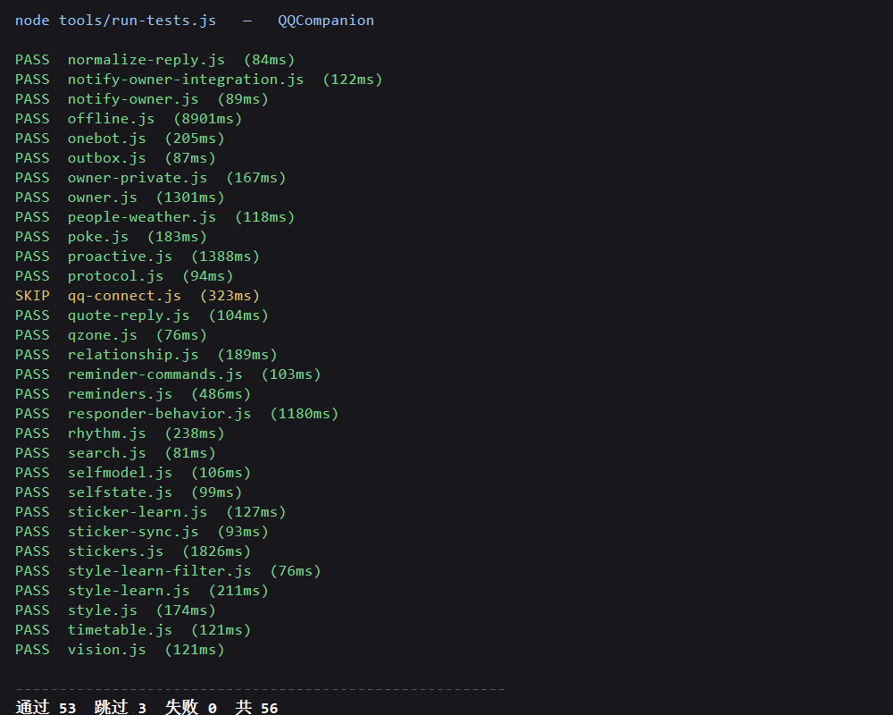

# QQCompanion — 一个能长期在线的 QQ 智能体

> 计算概论大作业项目 · 用 Node.js 从零实现，**零第三方运行时依赖**
> 把大模型接进自己天天用的 QQ，做出一个「有记忆、会记事、能提醒、不乱插嘴」的 AI 伙伴。

---

## 1. 项目背景与目标

### 1.1 为谁解决什么问题

我想在自己的 QQ 里有一个「随时能聊」的 AI 伙伴：发消息就有回复，聊过的事记得住，能帮我记日程、看课表、查天气，进群之后也像个正常人——该接话时接话，插不上话就安静。

现有方案都有明显不足：

| 方案 | 问题 |
| --- | --- |
| QQ 官方机器人平台 | 个人主体**无法被搜索、无法被加好友**，只能扫码临时会话；被动回复条数受限 |
| 直接逆向 QQ 协议 | 封号风险高，协议随时变更 |
| 现成「AI 聊天机器人」SaaS | 无长期记忆、无本地数据、不能自定义行为与运维 |

### 1.2 我的方案

采用 **OneBot v11 协议 + NapCat 协议端**（合法的第三方客户端外壳）作为「手」，大模型作为「脑」，自己实现中间的**会话调度、记忆、限流、运维**层：

```
QQ 客户端（手机/电脑） ⇄ NapCat（OneBot v11，WebSocket）
                              ⇅  本机
                       ┌──────────────────┐
                       │  QQCompanion     │  ← 本项目（Node.js）
                       │  调度 / 记忆 /   │
                       │  能力 / 运维     │
                       └────────┬─────────┘
                                ⇅ HTTPS
                       大模型 API（chat + vision）
```

### 1.3 已完成的核心功能

| 类别 | 功能 | 验收方式 |
| --- | --- | --- |
| 会话 | 私聊回复、长回复按语义切分成多条「气泡」、群聊只在该接话时接话 | 单测 + 真机 |
| 记忆 | 每用户对话记忆（40 轮 + 定期提炼摘要）、长期记忆（重要度 1–5、去重、淡出） | 单测 + 真机 |
| 知识 | 零依赖 BM25 检索的知识库（本地文档切片 + 倒排索引） | 单测（召回率） |
| 语言风格 | 从真实聊天记录（1600 句）统计句长/标点分布，生成风格提示词 + 后处理分行 | 统计脚本 + 单测 |
| 日程 | 自然语言增删改查提醒（相对时间/绝对时间/周几）、课表（单双周、提前提醒）、考试倒计时 | 单测 + 真机 |
| 信息 | 天气（open-meteo）、联网搜索（Bing RSS）、识图（多模态）、群名/好友备注簿 | 单测 + 真机 |
| 人设 | 关系层（对每个人的态度分档）、印象库（记得聊过什么）、自我状态（L2） | 单测 |
| 群聊 | 关键词触发、过期消息跳过、冷却与配额、主动答题、潜水模式、群聊记忆摘要 | 单测 + 真机 |
| 运维 | 实例租约锁（防双开）、发件箱重试、看护进程、掉线与交接模式（手机临时接管） | 单测 + 真机 |
| 安全 | 主人白名单、群里非 @ 不记忆、密钥只存本地、日志脱敏 | 单测 |

> 说明：仓库中不含任何真实账号、密钥、聊天记录与表情素材，全部以占位配置替代（见 §7）。

---

## 2. 课程知识与核心设计

这一节是本项目的重点：**哪些地方真的用到了课上的数据结构与算法，为什么这样选，代价是什么。**

### 2.1 数据结构选型与实际用途

| 课程内容 | 项目中的用途 | 选择理由与复杂度 |
| --- | --- | --- |
| **哈希表**（`dict` / `set` / `Map`） | ① `openid → 记忆`、`QQ 号 → 印象`、`备注名 → QQ 号` 的索引；② `msg_id` 去重集合；③ 表情名 → 文件路径 | 平均 $O(1)$ 查找。去重必须用 `Set` 而不是数组 `includes`（$O(n)$），否则每条消息都要扫全表 |
| **环形缓冲（ring buffer）** ★ | ① 每个会话最近 N 轮对话（`src/memory.js` 的 `RingBuffer`）；② `msg_id` 去重窗口 500 条（`src/onebot.js` 的 `_dedupeRing`）；③ 每小时发言时间戳 | **真环形**：固定容量数组 + 头指针 + 长度，满了覆盖最旧位置。写入 $O(1)$、不需要搬数据——对比 `slice(-N)` / `shift()` 的 $O(n)$ |
| **FIFO 缓存**（用 `Map` 的插入有序性实现） | 识图结果缓存、搜索结果缓存 | 命中 $O(1)$；超容量删最早插入的（`Map.keys().next()`）。比引入第三方库更轻 |
| **二分查找** ★ | 提醒调度「现在该发哪些」（`src/reminders.js` 的 `lowerBound`） | 待办按时间升序维护；`due(t)` 用**两次二分**框出 $[t-\text{grace}, t]$ 区间，$O(\log n)$ 定位后只对候选判断——取代了原来的「全表 `filter` + `sort`」 |
| **分桶 + 滑动窗口** ★ | 群聊热度（近 60 秒多少人、多少条） | 每条消息只往「当前这一分钟」的桶里 +1（更新 $O(1)$），查询时把窗口内的几个桶相加（$O(\text{窗口分钟数})$，与历史条数无关） |
| **贪心** | 长回复切分成多条气泡（尽量在句末标点切、每段 ≤ N 字） | 局部最优即全局可接受；不需要 DP（代价函数单调） |
| **双指针 / 线性扫描** | 分段时「先扫句末标点，没有再退到弱标点」；缓存过期清理只丢前缀 | 一次线性扫描 $O(n)$，不产生临时数组 |
| **字符串处理** | 中文标点补全、全角/半角归一、按 UTF-16 码元安全截断 | 见 §2.3 的「按长度截断」陷阱 |
| **BM25 检索 + 倒排索引** ★ | 本地知识库问答（`src/knowledge.js`） | 建索引时同时维护 `postings: 词项 → 文档下标集合`；查询先取各查询词倒排表的**并集**得到候选文档，**只对候选算分**，不遍历全库 |
| **指数退避** | 网关重连、API 限流重试 | 失败等待 $b \cdot r^k$（$r=1.4/1.8$，上限 60s），避免重试风暴 |
| **租约 / 心跳（lease）** | 防止同一账号起两个机器人实例（否则同一条消息会回两遍） | 写心跳文件，`now - mtime > 20s` 视为过期；等价于分布式系统的 lease，只是单机用文件实现 |
| **幂等** | 同 `msg_id` 重复推送只处理一次；发件箱失败重试不重复发送 | 用「已处理集合 + 状态文件」实现 at-most-once 的效果 |

> ★ 标记的五项在 `tools/algo-check.js` 里有自动校验：跑一下就能确认这些结构在源码里真实存在（而不是文档里写着好看）。

> 复杂度取舍说明：提醒队列的规模最多几十条，理论上也可以直接排序；但因为「每秒轮询 + 全表重排」在长时间运行下是稳定浪费，项目里改成了**维护有序 + 二分定位**，代价是插入时多一次 `sort`（$n$ 很小，$O(n\log n)$ 可忽略）。群热度同理：原来每次判定都要 `filter` 一遍说话记录，改成桶之后历史记录也不会无限变长。

### 2.2 三个值得说的算法点

**(1) 长回复切分（`src/rhythm.js` + `src/responder.js`）**

模型一次会吐出 100+ 字，直接发出去是一大坨，不像人。做法是两级切分：

```
文本 → 按行切 → 每行按句末标点（。！？!?）切句
     → 单句超长时：先向后扫句末标点，没有就退到弱标点（，、；）
     → 仍超长才硬切，但保证不落在 UTF-16 代理对中间
```

复杂度 $O(n)$；错误率用「切完拼回是否等于原文」来验证（单测断言不丢字）。

**(2) 群聊「该不该接话」的判定（`src/responder.js`）**

早期版本几乎「有消息就回」，结果群里插话太多且答非所问。现在是一串**短路判定**，每条都是 $O(1)$ 或 $O(k)$（k=关键词数）：

```
潜水模式？→ 不接
主人且在叫我？→ 一定接
命中关键词 且 不在冷却 且 未超配额 且 消息没过期(staleSkip) → 接
否则 → PASS（这条不接，最多贴个表情）
```

其中「消息没过期」是关键修复：群消息排队串行处理，等轮到它时话题可能已经过去了。

**(3) 记忆检索与注入预算（`src/memory.js` + `src/longterm.js`）**

每次请求都要把「历史 + 摘要 + 知识 + 关系」拼进提示词，但 token 是钱。做法：
- 历史按时间取最近 40 轮，**每条超长正文截断到 240 字**（文件/转发另算，可到 60000 字）；
- 摘要每 10 轮提炼一次，只保留要点；
- 知识库只在「看起来在问事实」时检索，命中才注入前 3 段。

实测提示词稳定在约 320 token（未优化前 1082），**缓存命中率约 85%**（把「当前时间」从系统提示词开头挪到末尾，让前缀保持稳定）。

### 2.3 踩过的「计算机原理」级坑（都写进了测试）

| 现象 | 根因 | 结论 |
| --- | --- | --- |
| 解压后 `Cannot find module 'src\main.js'` | 打包工具写了**反斜杠**作为 zip 路径分隔符，Linux 下变成文件名 | 跨平台必须用 `/` |
| PowerShell 改中文文件后 JSON 解析报 `Bad control character` | `Set-Content` 默认 ANSI/带 BOM，UTF-8 中文被写坏 | 改文本一律用明确 UTF-8 的 API；读 JSON 先剥 BOM |
| `.cmd` 报 `'tart' is not recognized` | 用 LF 换行写 CRLF 脚本，`cmd` 行解析错位 | Windows 批处理必须 CRLF |
| 机器人每 5 秒重启一次 | `const` 变量在声明前被引用（TDZ），`ReferenceError` 进崩溃循环 909 次/天 | 加了「假 fetch + 假 WebSocket 真跑一遍 main()」的启动测试 |
| 同一条消息回了两次 | 两个实例都以为自己该回 | 心跳租约锁 + 启动时清理残留 |
| 时间全差 8 小时 | 容器 `/etc/localtime` 是 UTC，代码里又叠加了一次偏移 | 统一「内部 UTC / 展示北京时间」，只在一处转换 |
| 电脑「没关」却掉线 | 系统进了现代待机（S0），网卡断、长连接断 | 需要把「系统电源策略」当成系统设计的一部分 |

### 2.4 复杂度与性能实测

| 指标 | 数值 | 说明 |
| --- | --- | --- |
| 私聊首响 | 0.8–1.3 s | 含一次模型调用 |
| 群聊平均回复 | ≈1.07 s（P90 2.4 s） | 群聊用更小 `maxTokens` 与更短历史 |
| 单条消息处理内存 | O(1) 摊还 | 环形缓冲固定容量 |
| 提示词规模 | ≈320 token | 三层优化后（历史截断/摘要/按需检索） |
| 测试 | 60 个测试脚本 + 5 个测试数据文件、约 1339 处断言、全绿（3 个按环境自动 SKIP） | `npm test` |

---

## 3. 目录结构

```text
repo/
├── src/                  # 48 个模块，约 15.1k 行（零第三方依赖）
│   ├── onebot.js         # OneBot v11 接入层：连接/重连/消息归一化/发送
│   ├── responder.js      # 会话调度核心：该不该回、怎么回、回几段
│   ├── brain.js          # 模型层：提示词组装、chat、识图、摘要
│   ├── memory.js         # 短期记忆（环形缓冲 + 定期摘要）
│   ├── longterm.js       # 长期记忆（重要度/去重/淡出）
│   ├── knowledge.js      # BM25 知识库
│   ├── rhythm.js         # 拟人节奏：气泡切分与间隔
│   ├── reminders.js      # 日程解析与调度
│   ├── timetable.js      # 课表（单双周 / 提前提醒）
│   ├── names.js          # 好友备注簿（备注 > 群名片 > 昵称）
│   ├── people.js         # 印象库（对每个人的态度分档）
│   ├── stickers.js       # 表情包（本地素材 + 学习新图）
│   ├── instance-lock.js  # 单实例租约锁
│   ├── outbox.js         # 发件箱（失败重试 / 上线补发）
│   └── ...               # search / weather / vision / modes / handover ...
├── test/                 # 60 个测试脚本 + 5 个数据文件，约 1339 处断言
├── assets/               # 表情索引示例与占位图
├── tools/run-tests.js    # 测试入口（自动准备 config.json）
├── docs/                 # 报告、架构图、演示材料
├── config.example.json   # 配置模板（不含任何真实凭据）
└── LICENSE               # MIT
```

---

## 4. 安装与运行

### 4.1 环境

- Node.js **≥ 22**（用到内置 `globalThis.WebSocket`，与 `package.json` 的 `engines` 一致）
- 一个 OneBot v11 协议端（如 NapCat），暴露 `ws://127.0.0.1:3001`
- 一个支持 OpenAI 兼容接口的大模型 API（本项目按 `deepseek-chat` 调通）

### 4.2 一键安装（推荐）

**Windows**（PowerShell，双击 `install.cmd` 也行）：

```powershell
irm https://raw.githubusercontent.com/illenial-eml/QQCompanion/main/install.ps1 | iex
```

**macOS / Linux / WSL**：

```bash
curl -fsSL https://raw.githubusercontent.com/illenial-eml/QQCompanion/main/install.sh | bash
```

脚本会依次做五件事：检查 Node/git → 克隆或更新代码 → 从模板生成 `config.json`（**已存在就绝不覆盖**）→ 建 `data/` → 跑一遍离线自检。幂等，重复执行安全。

常用参数：`-Dir D:\QQCompanion`（Windows）/ `QC_DIR=~/QC`（Linux）指定目录，`-NoTest` / `QC_NO_TEST=1` 跳过自检。

也可以只跑安装向导（不克隆，适合已经拿到代码的情况）：

```bash
node tools/install.js          # 安装：检查 → 生成配置 → 自检
node tools/install.js --dry    # 只看会做什么，不改文件
node tools/install.js --check  # 只体检
```

### 4.3 手动安装

```bash
git clone https://github.com/illenial-eml/QQCompanion.git && cd QQCompanion
cp config.example.json config.json     # 填写 apiKey / onebot.url / onebot.accessToken
node tools/run-tests.js                # 先确认本机环境（会打印每一组结果）
node src/onebot-main.js                # 启动机器人
```

`config.json` 最小示例（字段含义见文件内 `_说明`）：

```json
{
  "brain": { "apiKey": "sk-your-key", "model": "deepseek-chat" },
  "onebot": { "url": "ws://127.0.0.1:3001", "accessToken": "your-token", "selfId": "1000000001" },
  "qq": { "botNames": ["小鸿"], "ownerIds": ["1000000002"] }
}
```

### 4.4 最小使用示例

```
你：在干嘛呢
它：瘫着呢，上午没啥事干

你：明天中午 11:40 提醒我开会
它：记下了（第 1 条）：10 月 29 日周四 11:40 提醒你「开会」

你：我的日程有哪些
它：（编号列出今天/明天的安排）

你：我上号          ← 让电脑端下线，手机临时接管
它：好，我这就下线，手机上去看吧
```

---

## 5. 测试与结果

```bash
node tools/run-tests.js          # 全部
node test/responder-behavior.js  # 单个
```

| 类别 | 代表用例 | 结果 |
| --- | --- | --- |
| 协议 | 网关事件解析、消息去重、发送失败重试 | PASS |
| 会话调度 | 群聊 14 组场景（关键词/冷却/过期/主人/潜水） | PASS |
| 记忆 | 40 轮上限、摘要触发、跨天日期标注、隐私（群里非 @ 不记） | PASS |
| 日程 | 「明天 9 点」「30 分钟后」「周三五点」、取消第 N 条、听不懂给菜单 | PASS |
| 检索 | BM25 召回率、无关查询不注入 | PASS |
| 运维 | 租约锁单实例、发件箱补发、启动冒烟（假 WebSocket 跑 main） | PASS |
| 边界 | 空消息、纯表情、超长文本、UTF-8 代理对截断、非法 JSON 配置 | PASS |
| 自动 SKIP | 需要真实模型 key / 私有表情库的 3 个用例（无凭据时打印 SKIP 而不失败） | SKIP |



**失败案例**（如实记录，详见 `docs/项目报告.md` §5.2）：TDZ 崩溃循环、双实例双回复、群聊过期消息答非所问、PowerShell 写坏中文导致的配置解析失败。

---

## 6. 局限与改进

1. **依赖第三方协议端**：NapCat 升级/失效会直接影响可用性；官方协议没有「个人可被加好友」的通道，这是方案的根本约束。
2. **登录态与风控**：整机重启后可能需要重新扫码；同一账号多端登录会互踢（已用「交接模式」缓解，未根治）。
3. **回复质量依赖模型**：小模型偶尔跑题，已用「温度 + 输出规范 + 后处理」压制，但没有做强化学习或微调。
4. **知识库是纯检索**：没有做重排（rerank）与多跳问答。
5. **单机单进程**：没有分布式部署与水平扩展（对个人使用已足够）。

后续计划：把「检索 + 重排」补上；用 loRA 在自建语料上微调风格；把运维脚本产品化。

---

## 7. 隐私与数据说明

这个项目天生要碰聊天内容，所以从一开始就按「数据不出本机」设计：

- **不采集**：不做云端上报，不写第三方统计；所有数据落在 `data/`（已在 `.gitignore`）。
- **最小化**：群里非 @ 的消息**不写入记忆**；日志只记长度与耗时，正文可关。
- **可删除**：命令「忘掉 X」「你记住了什么」；`data/` 目录整删即可清空。
- **凭据**：API Key 只存在本机 `config.json`（不入库）；仓库里只有 `config.example.json` 占位。
- **本仓库的脱敏**：真实 QQ 号 → `1000000001` 等占位；真实昵称 → `Alice`/`小明`；聊天记录、表情素材、运维脚本里的 token 全部移除。

---

## 8. 来源与 AI 使用声明

```text
使用工具：DeepSeek（deepseek-chat / deepseek-flash），通过智能体框架进行多轮协作（累计 280 轮）
参与环节：需求拆解、方案比较、代码起草、调试定位、测试编写、文档整理
本人完成的设计、修改与判断：
  - 选题与需求定义、取舍（放弃官方机器人 / 放弃纯逆向、选 OneBot + 自研中间层）
  - 架构分层与模块边界；记忆/限流/租约/发件箱等关键机制的设计决定
  - 算法选型判断（哈希 vs 数组、二分 vs 堆、贪心分段 vs DP）
  - 全部代码的阅读、修改与验收；真机部署与运维（进程守护、电源策略、掉线排查）
  - 测试用例的补充与失败复现；本文档的事实核对
验证方法及结果：
  - 60 个测试脚本 / 约 1339 处断言全部通过（3 个按环境 SKIP）
  - 真机运行：私聊首响 0.8–1.3s；群聊平均 1.07s；连续运行数天并记录掉线原因
  - 对每个结论做可复现验证（日志、脚本、对照实验），失败的假设如实记录
代表性协作案例：docs/项目报告.md §5.2（三次「AI 判断错了、靠验证纠回来」的实录）
引用与复用的外部资源：
  - OneBot v11 协议规范（https://github.com/botuniverse/onebot-11）
  - NapCat 协议端（https://github.com/NapNeko/NapCatQQ）
  - open-meteo 天气 API、Bing RSS 搜索
  - Noto Emoji（表情占位素材，Apache-2.0）
```

---

## 9. 许可

MIT License，见 [LICENSE](LICENSE)。
